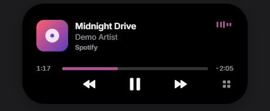
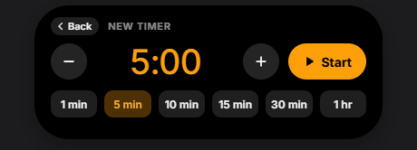

# Island

**A small, animated pill at the top of your Windows screen that shows what's going on: your music, timers, volume and more.** Hover over it and it reacts, click it to open, and it gets out of the way when you don't need it.

<p align="center">
  
</p>

<p align="center">
  <a href="https://github.com/yusufmj2005/island-for-windows/releases/latest"><b>⬇ Download the latest version</b></a>
  &nbsp;·&nbsp; Windows 10 and 11 &nbsp;·&nbsp; Free
</p>

---

## Install

1. Go to the [latest release](https://github.com/yusufmj2005/island-for-windows/releases/latest) and download **Island-Setup-x.y.z.exe**.
2. Run it. If Windows shows **"Windows protected your PC"**, click **More info → Run anyway**. (This appears because the installer isn't code-signed yet, not because something is wrong.)
3. Follow the steps. No administrator rights needed. Island starts right away and adds shortcuts to your Desktop and Start menu.

**Updating:** download the newer installer and run it over the old one. Your settings are kept.

---

## The basics

- **Island lives at the top centre of your screen**, below where a laptop's webcam usually is.
- **Hover** over it and it grows slightly. **Click** it to open it.
- **It closes by itself** when you move your mouse away.
- **Right-click** it for a quick menu and [Settings](#settings).
- **To quit:** click the island, then **Quit** (click twice to confirm), or right-click the Island icon in the taskbar's system tray, then **Quit Island**.

Island never takes focus away from the app you're using, so you can click it while typing or gaming.

---

## What it can do

### 🎵 Music


When Spotify, a browser or any other media app is playing, the island shows the album art and a moving waveform. **Click it** for the full player:

- **Play / pause, next, previous.**
- **Click or drag the progress bar** to jump to any point in the song (where the app allows it).
- **Click the album art** to bring the music app to the front.
- **Several apps playing?** A chip under the artist (e.g. *Spotify · 2 apps*) lets you choose which one the island controls.

### ⏱ Timers



Click the island, then **Timer**. Pick a duration with **−** / **+**, scroll over the time, or tap a preset. Then press **Start**.


The countdown stays on the island. Click it to **pause**, **cancel** or add **+1 min**. When the timer ends you'll hear a chime.

### 🔊 Volume


**Scroll on the island** to change the volume. The bar also appears when you use your keyboard's volume keys or Windows' volume slider. **Middle-click** the island (press the scroll wheel) to mute or unmute.

### 🎙 Microphone and camera indicator


A small dot appears next to the island while an app is using your **microphone (orange)** or **camera (green)**. Hover over it to see which app.

### 📸 Screenshot preview

Take a screenshot (**Win+Shift+S** or **Print Screen**) and a thumbnail pops up on the island. **Drag it** straight into Discord, WhatsApp, an email or a folder, or click **Save** to put it in *Pictures › Screenshots*.

### 🚀 Recent apps

Click the island to see your recently used apps. **Click one to open it.** Right-click an app to **pin** it to the front or **remove** it from the list.

### 🔋 Battery (laptops)


Plug in your charger and the island shows your battery level for a moment. It also warns you when the battery drops to 20% and 10%. Desktop PCs without a battery never show this.

### Two things at once

If music is playing and a timer is running, the second one appears as a small bubble beside the island. Click the bubble to switch which one is shown.

---

## Tips and shortcuts

| Do this | To |
|---|---|
| **Click** the island | Open it |
| **Scroll** on the island | Change the volume |
| **Middle-click** the island | Mute / unmute |
| **Right-click** the island | Quick menu, including Settings |
| **Ctrl + Alt + Space** | Hide or show the island instantly (handy before screen-sharing). If another app already uses it, Island uses **Ctrl + Alt + I** instead. The right-click menu shows which. |
| Move the mouse to the top centre | Bring the island back after it has faded away |

Island fades away after **10 seconds** with nothing happening (you can change this in Settings), and hides itself while a **fullscreen** game or video is in front. Your timers and music keep going in the background.

---

## Settings

Open **Settings** by right-clicking the island (or the Island icon in the system tray), or from the island itself: click it, then **Settings**. Changes apply right away.

| Setting | What it does |
|---|---|
| **Open at login** | Start Island automatically when you sign in to Windows |
| **Screenshot previews** | Turn screenshot thumbnails on or off |
| **Hide when idle** | Fade the island away when nothing is happening, after 5, 10, 30 or 60 seconds |
| **Hide in fullscreen apps** | Hide during fullscreen games and videos |
| **Position** | Slide the island left, right or down, if your webcam isn't exactly in the middle |
| **Recent apps** | Clear the list (pinned apps stay) |
| **About** | Your version, the GitHub page, the diagnostics log, and Quit |

The right-click menu also has **Hide island** and a quick **Start 5 min timer**.

---

## Privacy

Everything stays on your PC. Island has no account, sends no data anywhere and doesn't track you. Your recent apps list, timers and settings are stored only in `%APPDATA%\Island`.

---

## Troubleshooting

**Windows says "Windows protected your PC" when installing.**
Click **More info → Run anyway**. This happens because the installer isn't code-signed yet.

**The island doesn't show my music.**
Island shows apps that use Windows' media controls (Spotify, Chrome, Edge, Firefox and most media apps). Make sure something is playing. Paused music disappears from the island after a minute.

**I can't drag the progress bar.**
Some apps don't allow jumping within a track. The bar only becomes draggable when the app supports it.

**The camera dot never appears.**
Some recent Windows versions no longer report camera use in a way Island can read. The microphone dot works on all versions.

**The island disappeared.**
It fades when nothing is happening. Move your mouse to the top centre of the screen to bring it back. If you pressed the hide shortcut, press it again. If a fullscreen app is open, it comes back when you leave it.

**The island is in the wrong place.**
Open **Settings** and use the **Position** sliders. If you have several monitors, Island currently appears on your main display only.

**Something else isn't working.**
Open **Settings**, then **Open log**, and include the log when you [report the problem](https://github.com/yusufmj2005/island-for-windows/issues).

---

## Uninstall

Open **Settings → Apps → Installed apps**, find **Island**, and choose **Uninstall**.

---

## Known limitations

- Shows on your **main display only**.
- **Camera** detection doesn't work on some recent Windows builds (the microphone does).
- Not code-signed yet, so you'll see the SmartScreen prompt on first install.

---

## For developers

Island is built with Electron, React, TypeScript and Framer Motion. A small Windows PowerShell helper (`resources/windows-helper.ps1`) talks to Windows for media sessions, volume, the battery, the microphone, fullscreen detection and recent apps.

```bash
npm install
npm run dev        # run with hot reload
npm start          # build and run
npm run typecheck
npm run dist       # build the installer into release/
```

Requires Windows 10/11 and Node 22+.

<details>
<summary>Project layout</summary>

```
electron/main/          Electron main process: the window, click-through, menus, IPC
  TimerService.ts       timers
  RecentAppsService.ts  recent apps (matched to Start menu entries)
  ScreenshotService.ts  screenshot previews
  WindowsHelper.ts      runs the PowerShell helper
  media/                media session state
electron/preload/       the small, typed bridge to the UI
src/                    React UI
  components/Island.tsx the morphing pill and its views
  views/                music, timer, launcher and other views
  settings/             the settings window
resources/              the PowerShell helper and icons
```

</details>
